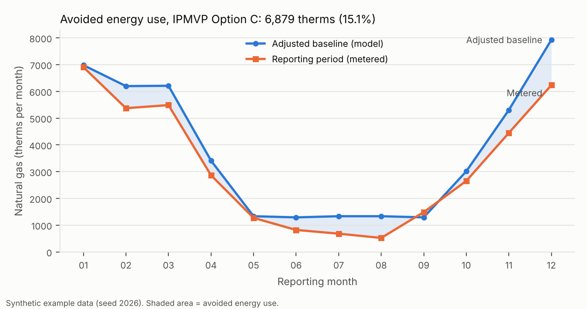

# MUNI-LCC

[](https://github.com/Olumide-Akindipe/muni-lcc/actions/workflows/tests.yml)

**Status: Released v0.1.0 (14 October 2026). DOI: [10.5281/zenodo.23362541](https://doi.org/10.5281/zenodo.23362541).**

MUNI-LCC is a free, open toolkit that helps a city, town, village, or school district answer three questions about an energy project: were the intended energy savings achieved, was it a sound investment over its life cycle, and what does the federal performance report need to say about it. This toolkit implements IPMVP Options A and C as defined in the DOE FEMP M&V Guidelines v5.0 (which are based on IPMVP Core Concepts 2022), computes life-cycle cost consistent with ASTM E917, applies these methods the same way every time, shows its work, and produces performance report content aligned with 2 CFR 200.329.

## Why

Federal and state programs fund energy upgrades in small and mid-sized municipalities, and the Uniform Guidance requires recipients to report accomplishments against objectives and to explain shortfalls and cost overruns. Large agencies verify savings with consultants and proprietary software. Small municipalities usually report engineering estimates instead. MUNI-LCC makes standardized verification and life-cycle costing available without license fees or specialist software, ensuring that reported outcomes are based on metered evidence.

## What it does

| Module | Method | Output |
|---|---|---|
| `lcc` | ASTM E917 life-cycle cost, NIST Handbook 135 factors (SPV, UPV, modified UPV with escalation or price indices) | LCC by cost category; net savings, SIR, AIRR, simple and discounted payback |
| `mv_option_a` | IPMVP Option A as defined in FEMP M&V Guidelines v5.0: key parameter measurement with documented stipulation | Savings with measurement uncertainty; measured versus stipulated parameters recorded |
| `mv_option_c` | IPMVP Option C as defined in FEMP M&V Guidelines v5.0: whole-meter change-point regression (mean, 2P, 3PC, 3PH, 4P, 5P) | Avoided energy use; CV(RMSE), NMBE, R-squared, slope t-statistics; fractional savings uncertainty; acceptance checks using FEMP v5.0 values where stated |
| `report` | 2 CFR 200.329(c)(1), (c)(2), (e), as amended April 2024 | Due date; accomplishments versus objectives; reasons for shortfalls; cost and unit-cost analysis; significant developments; completeness check |

Life-cycle costs can be computed from verified quantities, so the cost-effectiveness reported to a funder rests on measured savings rather than projected ones.

## Install and run

Requires Python 3.9 or later.

```bash
git clone https://github.com/Olumide-Akindipe/muni-lcc.git
cd muni-lcc
pip install -e ".[test,examples]"
python -m pytest                      # 33 tests should pass
muni-lcc run examples/project.json --out outputs
muni-lcc due-date 2026-06-30 annual   # prints 2026-09-28
```

`muni-lcc run` writes `results.json`, `performance_report.md`, and `performance_report.json`. Inputs are described in [docs/INPUTS.md](docs/INPUTS.md).

## Worked example (synthetic data)

`examples/` contains a hypothetical Town Hall with synthetic monthly gas bills and lighting readings, generated with a fixed seed so the true answer is known in advance. The toolkit is checked against that answer.

* Option C selected a 3PH baseline model on 24 months: CV(RMSE) 7.9 percent, R-squared 0.988, slope t-statistic 42.3. It meets every acceptance criterion, including the FEMP v5.0 values for R-squared, bias, and t-statistic.
* Verified avoided gas use: 6,879 therms (15.1 percent), with fractional savings uncertainty of 34.2 percent at 90 percent confidence. The true injected savings were 6,629 therms (15.0 percent), inside the uncertainty band.
* Option A lighting savings: 28,392 kWh per year, matching the true value of 28,392 kWh.
* Life-cycle cost over 25 years at a 3.0 percent real discount rate: net savings $151,675, SIR 2.27, AIRR 6.4 percent, discounted payback 9.0 years.

Sample output: [examples/outputs/performance_report.md](examples/outputs/performance_report.md). Every number above is read from `examples/outputs/stats.json`.



## Method sources

1. U.S. Department of Energy, Federal Energy Management Program. *M&V Guidelines: Measurement and Verification for Performance-Based Contracts, Version 5.0.* Prepared by Pacific Northwest National Laboratory. September 2024. https://www.energy.gov/sites/default/files/2024-10/mv_guide_5_0.pdf
2. Efficiency Valuation Organization. *International Performance Measurement and Verification Protocol: Core Concepts 2022.* EVO 10000-1:2022. The IPMVP edition on which FEMP v5.0 is based. Options A and C are implemented as defined in FEMP v5.0.
3. ASTM International. *ASTM E917-17(2023), Standard Practice for Measuring Life-Cycle Costs of Buildings and Building Systems.* Implemented from the equivalent public formulation in NIST Handbook 135.
4. Fuller, S. K., and Petersen, S. R. *Life-Cycle Costing Manual for the Federal Energy Management Program, NIST Handbook 135.* 1996.
5. National Institute of Standards and Technology. *Energy Price Indices and Discount Factors for Life-Cycle Cost Analysis, 2025.* NIST IR 85-3273-40. August 2025.
6. 2 CFR 200.329, Monitoring and reporting program performance, as amended at 89 FR 30136 (April 22, 2024). https://www.ecfr.gov/current/title-2/section-200.329
7. ASHRAE. *Guideline 14-2023, Measurement of Energy, Demand, and Water Savings.* The edition FEMP v5.0 cites. Model statistics and the fractional savings uncertainty approximation.
8. Efficiency Valuation Organization. *Uncertainty Assessment for IPMVP.* EVO 10100-1:2018. The uncertainty guidance FEMP v5.0 cites; see METHODS.md for how MUNI-LCC's uncertainty method relates to it.

Details, equations, and conventions: [docs/METHODS.md](docs/METHODS.md). What the toolkit cannot do: [docs/LIMITATIONS.md](docs/LIMITATIONS.md).

## Scope note

MUNI-LCC produces verified content for a performance report. It does not replace the OMB-approved form an awarding agency prescribes, an M&V plan agreed with the funder, or professional engineering judgment. Its acceptance thresholds are configurable guidance values; the project's M&V plan governs.

## Citation

Akindipe, S. O. (2026). *MUNI-LCC: open life-cycle cost and measurement-and-verification toolkit for municipal energy projects* (Version 0.1.0) [Computer software]. Zenodo. https://doi.org/10.5281/zenodo.23362541

See [CITATION.cff](CITATION.cff).

## License and maintainer

Code: MIT ([LICENSE](LICENSE)). Documentation: CC BY 4.0.
Maintainer: Stephen Olumide Akindipe, Independent Researcher, Albany, NY, USA. ORCID [0000-0002-1846-9662](https://orcid.org/0000-0002-1846-9662). 
Contributions welcome: [CONTRIBUTING.md](CONTRIBUTING.md). 
Support: [SUPPORT.md](SUPPORT.md). 
Governance: [GOVERNANCE.md](GOVERNANCE.md). 
Changes: [CHANGELOG.md](CHANGELOG.md).
